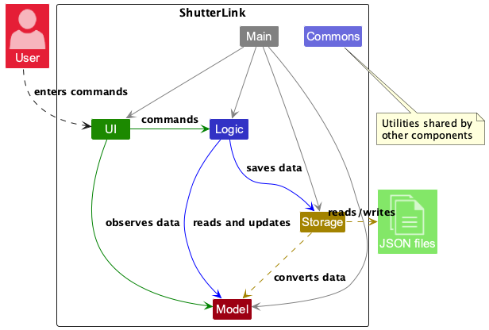
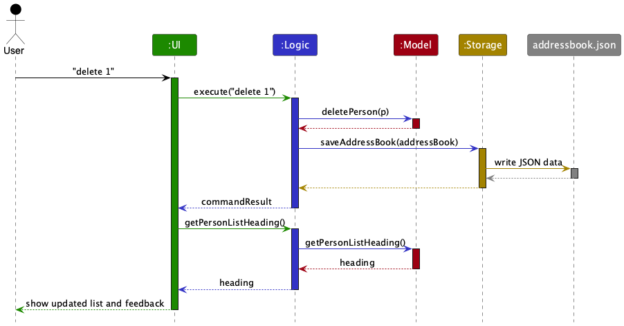
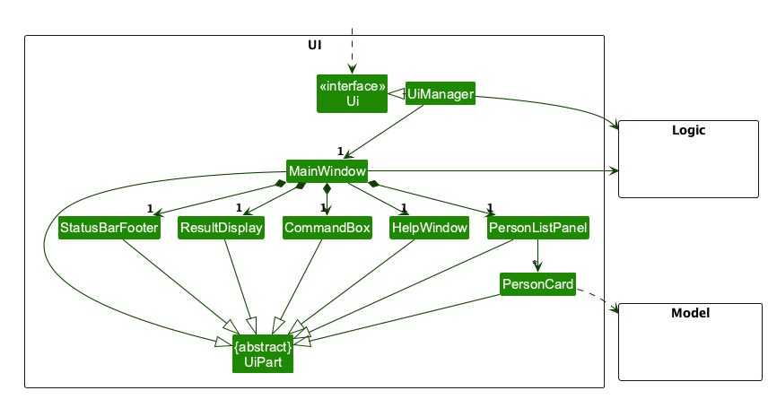
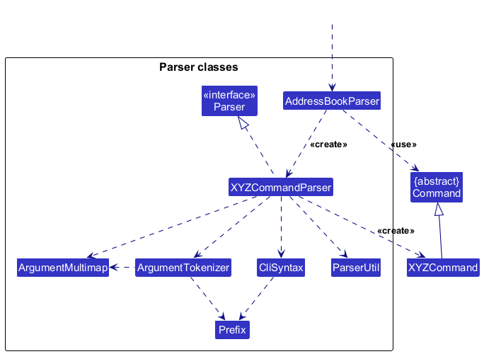
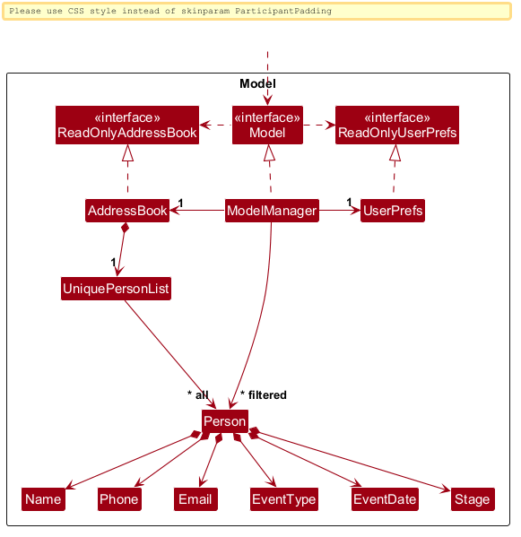
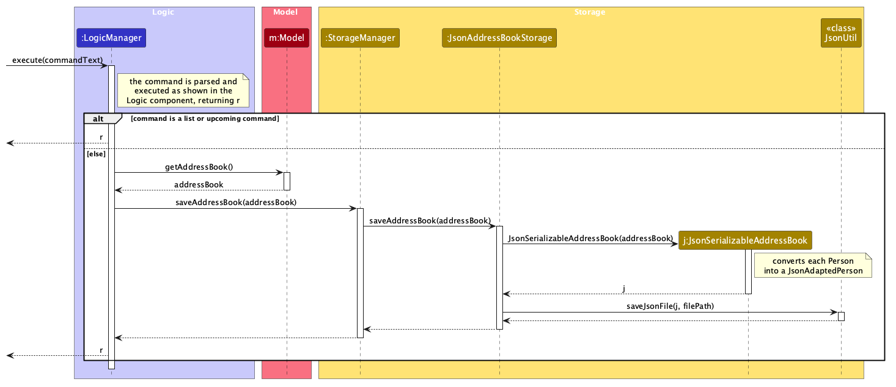

* Table of Contents
{:toc}

--------------------------------------------------------------------------------------------------------------------

## **Acknowledgements**

ShutterLink is based on [AddressBook-Level3](https://github.com/se-edu/addressbook-level3) by the SE-EDU initiative.
It uses JavaFX for the UI, Jackson for JSON serialization, JUnit 5 for testing, and Gradle for builds.

--------------------------------------------------------------------------------------------------------------------

## **Setting up, getting started**

Refer to the guide [_Setting up and getting started_](SettingUp.md).

--------------------------------------------------------------------------------------------------------------------

## **Design**

:bulb: **Tip:** The `.puml` files used to create diagrams are in `docs/diagrams`. Refer to the [_PlantUML Tutorial_ at se-edu/guides](https://se-education.org/guides/tutorials/plantUml.html) to learn how to create and edit diagrams.

### Architecture

The ***Architecture Diagram*** given above explains the high-level design of the App.

The following provides a quick overview of the main components and their interactions.

**Main components of the architecture**

**`Main`** (consisting of classes
[`Main`](https://github.com/AY2627S1-CS2103T-T08-3/tp/blob/master/src/main/java/seedu/address/Main.java) and
[`MainApp`](https://github.com/AY2627S1-CS2103T-T08-3/tp/blob/master/src/main/java/seedu/address/MainApp.java)) is in
charge of app launch and shutdown.
* At app launch, it initializes the other components in the correct sequence, and connects them up with each other.
* At shut down, it shuts down the other components and invokes cleanup methods where necessary.

The bulk of the app's work is done by the following four components:

* [**`UI`**](#ui-component): The UI of the App.
* [**`Logic`**](#logic-component): The command executor.
* [**`Model`**](#model-component): Holds the data of the App in memory.
* [**`Storage`**](#storage-component): Reads data from, and writes data to, the hard disk.

[**`Commons`**](#common-classes) represents a collection of classes used by multiple other components.

**How the architecture components interact with each other**

The *Sequence Diagram* below shows how the components interact with each other for the scenario where the user issues the command `delete 1`.

Each of the four main components (also shown in the diagram above),

* defines its *API* in an `interface` with the same name as the Component.
* provides its functionality through a concrete `{Component Name}Manager` class that implements the corresponding API interface.

For example, the `Logic` component defines its API in `Logic.java` and implements it in `LogicManager.java`. Other components interact with a component through its interface rather than its concrete class, preventing them from coupling to that component's implementation, as illustrated in the following partial class diagram.

The sections below give more details of each component.

### UI component

The **API** of this component is specified in
[`Ui.java`](https://github.com/AY2627S1-CS2103T-T08-3/tp/blob/master/src/main/java/seedu/address/ui/Ui.java).

The UI consists of a `MainWindow` and its parts, such as `CommandBox`, `ResultDisplay`, `PersonListPanel`, and `StatusBarFooter`. All of these, including `MainWindow`, inherit from the abstract `UiPart` class, which captures common behavior among classes that represent visible GUI parts.

The `UI` component uses the JavaFX UI framework. The layouts of these UI parts are defined in matching `.fxml` files
in `src/main/resources/view`. For example,
[`MainWindow.fxml`](https://github.com/AY2627S1-CS2103T-T08-3/tp/blob/master/src/main/resources/view/MainWindow.fxml)
specifies the layout of
[`MainWindow`](https://github.com/AY2627S1-CS2103T-T08-3/tp/blob/master/src/main/java/seedu/address/ui/MainWindow.java).

The `UI` component,

* executes user commands using the `Logic` component.
* listens for changes to `Model` data so that the UI can be updated with the modified data.
* keeps a reference to the `Logic` component, because the `UI` relies on the `Logic` to execute commands.
* depends on some classes in the `Model` component because it displays `Person` objects from the model.

### Logic component

**API**:
[`Logic.java`](https://github.com/AY2627S1-CS2103T-T08-3/tp/blob/master/src/main/java/seedu/address/logic/Logic.java)

Here's a (partial) class diagram of the `Logic` component:

The sequence diagram below illustrates the parsing and command-execution portion of the `Logic` component, taking
the `execute("delete 1")` API call as an example. The subsequent storage write is shown in the architecture sequence
diagram above.

:information_source: **Note:** The lifeline for `DeleteCommandParser` should end at the destroy marker (X), but due to a limitation of PlantUML, it continues to the end of the diagram.

How the `Logic` component works:

1. When `Logic` is called upon to execute a command, the command is passed to an `AddressBookParser` object, which in turn creates a parser that matches the command (e.g., `DeleteCommandParser`) and uses it to parse the command.
1. This results in a `Command` object (more precisely, an object of one of its subclasses e.g., `DeleteCommand`) which is executed by the `LogicManager`.
1. The command can communicate with the `Model` when it is executed (e.g. to delete an engagement). 
   Note that although this is shown as a single step in the diagram above for simplicity, the code can require several interactions between the command object and the `Model` to complete the operation.
1. The result of the command execution is encapsulated as a `CommandResult` object which is returned from `Logic`.
1. Unless the command only changes the view (`list` and `upcoming`), `LogicManager` then saves the address book
   through `Storage` (see [Persistence after commands](#persistence-after-commands)).

The sequence diagram below shows the execution portion for a command that modifies data, using `add` as an example.
Parsing works the same way as in the `delete 1` example above, so it is omitted.

`AddCommand` first asks the `Model` whether the new engagement duplicates an existing one, and fails with a
`CommandException` if so. Otherwise, it adds the engagement, shows all engagements so that the displayed indexes cover
every engagement, and asks `SimilarContactWarning` for a possible-typo warning about engagements of other clients that
share the same phone number or email. The warning, if any, is appended to the result message.

Here are the other classes in `Logic` (omitted from the class diagram above) that are used for parsing a user command:

How the parsing works:
* When called upon to parse a user command, the `AddressBookParser` class creates an `XYZCommandParser` (`XYZ` is a placeholder for the specific command name, e.g., `AddCommandParser`). The parser uses the other classes shown above to parse the user command and create an `XYZCommand` object (e.g., `AddCommand`). The `AddressBookParser` returns that object as a `Command` object.
* All `XYZCommandParser` classes, such as `AddCommandParser` and `DeleteCommandParser`, implement the `Parser` interface so they can be treated similarly where appropriate, for example during testing.
* Commands that take no arguments (e.g., `clear`, `help`, `exit`) are created by `AddressBookParser` directly, without
  an `XYZCommandParser`.

### Model component
**API**:
[`Model.java`](https://github.com/AY2627S1-CS2103T-T08-3/tp/blob/master/src/main/java/seedu/address/model/Model.java)

The `Model` component,

* stores the address book data i.e., all `Person` objects (which are contained in a `UniquePersonList` object).
* represents each `Person` as one photography engagement containing a client's `Name`, `Phone`, `Email`,
  `EventType`, `EventDate`, and `Stage`.
* represents the engagement stage as the `Stage` enum, whose values are ordered from `Enquiry` to `Delivered` so that
  `advance` can move an engagement to the next stage.
* treats two `Person` objects as the same engagement (`Person#isSameEngagement`) when their name, phone, email, event
  type and event date all match, ignoring case for the name, email and event type. The stage is not part of this
  identity. `UniquePersonList` uses this check to reject duplicates.
* maintains the _displayed_ list of `Person` objects in two layers: a `FilteredList` that selects which engagements
  are shown (e.g., search results or the upcoming-events window), wrapped by a `SortedList` that optionally orders them
  by event date (e.g., `list sort/date`). `getFilteredPersonList()` returns this displayed list as an unmodifiable
  `ObservableList<Person>` that the UI observes, so the UI updates when the list changes. Command indexes such as
  `edit 2` refer to positions in this displayed list.
* stores a `UserPrefs` object that represents the user’s preferences (currently, just the GUI settings). This is exposed to the outside as a `ReadOnlyUserPrefs` object.
* does not depend on any of the other three components (as the `Model` represents data entities of the domain, they should make sense on their own without depending on other components)

### Storage component

**API**:
[`Storage.java`](https://github.com/AY2627S1-CS2103T-T08-3/tp/blob/master/src/main/java/seedu/address/storage/Storage.java)

The `Storage` component,
* can save both address book data and user preference data in JSON format, and read them back into corresponding objects.
* is implemented by `StorageManager`, which delegates the actual JSON file access to `JsonAddressBookStorage` and `JsonUserPrefsStorage` (one class per data file).
* converts each `Person` to and from a `JsonAdaptedPerson`, including its event type, ISO-8601 event date,
  and engagement stage.
* depends on some classes in the `Model` component (because the `Storage` component's job is to save/retrieve objects that belong to the `Model`)

### Common classes

Classes used by multiple components are in the `seedu.address.commons` package.

--------------------------------------------------------------------------------------------------------------------

## **Implementation**

This section describes some noteworthy details on how certain features are implemented.

### Viewing upcoming events

`UpcomingCommandParser` accepts the case-insensitive, argument-free `upcoming` command. Invalid arguments,
including line breaks, are rejected before execution. `UpcomingCommand` obtains the current local date from a
`Clock` at execution time and calculates the inclusive end date with `plusDays(6)`. Tests supply fixed or mutable
clocks to cover timezone differences, daylight-saving transitions, leap years and rerunning after midnight.
Both boundaries are calculated before changing the model, so a date failure leaves the previous view intact.

`Model#showUpcomingPersons` replaces the existing filter with an inclusive date-range predicate over all saved
engagements, then reuses the list feature's date sorter with insertion-order ties. The model retains the date window
for the `Upcoming: START_DATE to END_DATE (N)` heading. Other view updates clear that window. The existing list
panel displays the heading and renumbers cards; index-based commands therefore use the upcoming view.
No stage restriction is applied. The selected window stays fixed until the command is executed again.

`LogicManager` skips storage writes for `UpcomingCommand`, just as it does for `ListCommand`. Tests verify that
the command works without writable storage, neither changes existing files nor creates missing files, and
preserves the previous view on invalid input. The persistent insertion order is unchanged.

### Listing engagements and sorting by event date

`ListCommandParser` accepts `list` and `list sort/date`, rejecting extra positional arguments,
unsupported/repeated prefixes, empty values and invalid sort options before changing the model.
List-specific parsing is case-insensitive and preserves raw arguments to reject embedded control characters.
Stage filtering is deferred; `stage/` is currently an unsupported list parameter.

`ListCommand` calls `Model#showAllPersons` to clear the current filter and select an ordering.
`ModelManager` exposes a `SortedList<Person>` over its `FilteredList<Person>` to the UI and index-based commands.
For date sorting, it compares the existing `EventDate.value` (`LocalDate`) and breaks ties by the record's
position in the underlying address book. Plain listing removes the comparator, restoring insertion order.
The stored list itself is never sorted. Updating a filter removes date sorting so a later search is in
insertion order. Deleting from a date-sorted view resets that view after selecting the displayed engagement.

`LogicManager` skips storage writes for `ListCommand`: viewing engagements does not require write access to the
JSON file. Other commands retain their existing saving behaviour. `Model#getPersonListHeading` supplies the
heading and count through `Logic`; `MainWindow` refreshes a simple label in `PersonListPanel` after successful
commands. A filtered view uses the neutral placeholder `Contacts (N)` for future search-UI refinement.

Tests cover empty and single-record lists, past/future dates, ties, filter/sort resets, displayed-index
edit/advance/delete integration, failed-input view preservation and unchanged persisted order across restarts.

### Managing engagement stages

`Stage` is a required enum field of every `Person`. `Stage#fromString` accepts the five display values
case-insensitively after trimming surrounding whitespace: `Enquiry`, `Booked`, `Shot Completed`,
`Awaiting Payment`, and `Delivered`. JSON loading is strict: a missing or invalid `stage` makes the entire data file
invalid rather than assigning a default.

`AddCommandParser` accepts an optional `s/STAGE`; when it is absent, the parser constructs the engagement with
`Stage.ENQUIRY`. `EditCommandParser` stores a supplied stage in `EditPersonDescriptor`. The descriptor uses
`Optional<Stage>` to distinguish “stage not supplied in this edit” from a stage value; `Person#getStage` itself
returns a non-null `Stage`.

`AdvanceStageCommand` takes the engagement at the displayed index and asks `Stage#getNextStage` for its successor.
It constructs a new immutable `Person` with the same client and event fields, replaces the old object through
`Model#setPerson`, and returns to the complete insertion-ordered list. `Delivered` has no successor and produces a
command error without modifying the model or view. Direct editing can move a stage either forward or backward.

Stage is deliberately excluded from `Person#isSameEngagement`, so changing only the stage cannot create a distinct
duplicate. Engagement identity uses name, normalized phone, normalized email, event type, and event date; name,
email, and event type comparisons are case-insensitive.

### Finding engagements

`FindCommandParser` requires exactly one of `n/`, `p/`, `e/`, or `t/` with a non-blank search value. It does not
validate the search text as a complete field value. `PersonSearchPredicate` performs a case-insensitive substring
comparison against the selected stored field. Consequently, `find e/alice@` is valid and can match
`alice@example.com`. Phone values are stored without spaces or hyphens, but search text is not normalized, so users
should normally search phone numbers using digits only.

Executing `find` removes date sorting, replaces the previous predicate, and assigns indexes to the matching view.
Index-based commands operate on that view. A successful add, edit, or advance restores the complete list; deleting
from a search leaves the remaining search matches visible.

### Persistence after commands

The sequence diagram below shows how `LogicManager` saves the data after a command that may change it.

`StorageManager` delegates to `JsonAddressBookStorage`, which converts the address book into a
`JsonSerializableAddressBook` (one `JsonAdaptedPerson` per engagement) and writes it to the data file using `JsonUtil`.
The whole address book is rewritten on every save.

`LogicManager#execute` parses and executes a command before deciding whether to save. `ListCommand` and
`UpcomingCommand` are the only commands that skip `Storage#saveAddressBook`, because they change only the view.
All other successfully executed commands currently attempt a write, including `find`, `help`, and `exit`.

If a storage write fails, `LogicManager` throws a `CommandException`. The command has already executed, however, so
an add, edit, advance, delete, or clear remains applied to the in-memory model for the current session. There is no
rollback; the data file retains its last successfully written state. On startup, a missing file loads sample data,
whereas a malformed or otherwise unreadable file loads an empty address book and leaves the bad file untouched until
a later command successfully writes data.

### \[Proposed\] Undo/redo feature

#### Proposed Implementation

The proposed undo/redo mechanism is facilitated by `VersionedAddressBook`. It extends `AddressBook` with an undo/redo history, stored internally as an `addressBookStateList` and `currentStatePointer`. Additionally, it implements the following operations:

* `VersionedAddressBook#commit()` — Saves the current address book state in its history.
* `VersionedAddressBook#undo()` — Restores the previous address book state from its history.
* `VersionedAddressBook#redo()` — Restores a previously undone address book state from its history.

These operations are exposed in the `Model` interface as `Model#commitAddressBook()`, `Model#undoAddressBook()` and `Model#redoAddressBook()` respectively.

Given below is an example usage scenario and how the undo/redo mechanism behaves at each step.

Step 1. The user launches the application for the first time. The `VersionedAddressBook` will be initialized with the initial address book state, and the `currentStatePointer` pointing to that single address book state.

Step 2. The user executes `delete 5` to delete the fifth engagement. The `delete` command calls
`Model#commitAddressBook()`, causing the modified address book state to be saved in the `addressBookStateList`, and
the `currentStatePointer` is shifted to the newly inserted state.

Step 3. The user executes
`add n/David Li p/91234567 e/david@example.com t/Wedding d/2027-01-15` to add a new engagement. The `add` command
also calls `Model#commitAddressBook()`, causing another modified address book state to be saved into the
`addressBookStateList`.

:information_source: **Note:** If a command fails its execution, it will not call `Model#commitAddressBook()`, so the address book state will not be saved into the `addressBookStateList`.

Step 4. The user decides that adding the engagement was a mistake and executes `undo`. The `undo` command calls
`Model#undoAddressBook()`, shifts the `currentStatePointer` once to the left, and restores the previous address book
state.

:information_source: **Note:** If the `currentStatePointer` is at index 0, pointing to the initial AddressBook state, then there are no previous AddressBook states to restore. The `undo` command uses `Model#canUndoAddressBook()` to check if this is the case. If so, it will return an error to the user rather
than attempting to perform the undo.

The following sequence diagram shows how an undo operation goes through the `Logic` component:

:information_source: **Note:** The lifeline for `UndoCommand` should end at the destroy marker (X), but due to a limitation of PlantUML, it continues to the end of the diagram.

Similarly, how an undo operation goes through the `Model` component is shown below:

The `redo` command does the opposite — it calls `Model#redoAddressBook()`, which shifts the `currentStatePointer` once to the right, pointing to the previously undone state, and restores the address book to that state.

:information_source: **Note:** If the `currentStatePointer` is at index `addressBookStateList.size() - 1`, pointing to the latest address book state, then there are no undone AddressBook states to restore. The `redo` command uses `Model#canRedoAddressBook()` to check if this is the case. If so, it will return an error to the user rather than attempting to perform the redo.

Step 5. The user then decides to execute the command `list`. Commands that do not modify the address book, such as `list`, will usually not call `Model#commitAddressBook()`, `Model#undoAddressBook()` or `Model#redoAddressBook()`. Thus, the `addressBookStateList` remains unchanged.

Step 6. The user executes `clear`, which calls `Model#commitAddressBook()`. Since the `currentStatePointer` is not
pointing at the end of the `addressBookStateList`, all address book states after the `currentStatePointer` will be
purged. It no longer makes sense to redo the earlier `add` command. This is the behavior that most modern desktop
applications follow.

The following activity diagram summarizes what happens when a user executes a new command:

#### Design considerations:

**Aspect: How undo & redo execute:**

* **Alternative 1 (proposed choice):** Saves the entire address book.
  * Pros: Easy to implement.
  * Cons: May have performance issues in terms of memory usage.

* **Alternative 2:** Individual command knows how to undo/redo by
  itself.
  * Pros: Will use less memory (e.g. for `delete`, save only the engagement being deleted).
  * Cons: We must ensure that the implementation of each individual command is correct.

### \[Proposed\] Data archiving

Data archiving is not implemented in the current version. Its storage representation and command workflow are still
to be decided.

--------------------------------------------------------------------------------------------------------------------

## **Documentation, logging, testing, dev-ops**

* [Documentation guide](Documentation.md)
* [Testing guide](Testing.md)
* [Logging guide](Logging.md)
* [DevOps guide](DevOps.md)

--------------------------------------------------------------------------------------------------------------------

## **Appendix: Requirements**

### Product scope

**Target user profile**:

* is a freelance photographer who handles event-based jobs
* has a need to manage a significant number of clients and photography jobs
* needs to track client contact details, event details, and job progress from enquiry to delivery
* prefers desktop apps over other types of applications
* can type fast
* prefers typing to mouse interactions
* is reasonably comfortable using CLI apps

**Value proposition**: Manage photography engagements from enquiry to delivery faster than with a typical
mouse-driven GUI application.

### User stories

Priorities: High (must have) - `* * *`, Medium (nice to have) - `* *`, Low (unlikely to have) - `*`

In these stories, an **engagement** is the record being added, edited, searched, displayed, and deleted. A **client**
is the person associated with that engagement, identified in the current model by the combination of name, normalized
phone number, and normalized email address. Clients are not stored as separate objects, so multiple engagements for
the same client repeat those three fields.

| Priority | User story |
| -------- | ---------- |
| `***` | As a photographer, I can add an engagement with client contact details, event details, and an optional initial stage, so that I can record work at any point in its lifecycle. |
| `***` | As a photographer, I can set an engagement's stage, such as enquiry, booked, shot completed, awaiting payment, or delivered, so that I always know what needs to happen next. |
| `***` | As a photographer, I can edit an engagement's client, event, or stage details, so that I can keep its information accurate as things change. |
| `***` | As a photographer, I can delete an engagement, so that my engagement list does not fill up with irrelevant work. |
| `***` | As a photographer, I can search engagements by client phone number or email address, so that I can find a client's work even when I do not remember their name. |
| `***` | As a photographer, I can search engagements by event type, so that I can quickly locate specific types of shoots. |
| `***` | As a photographer, I can view engagements sorted by event date, including past events, so that I can review them chronologically. |
| `***` _(planned)_ | As a photographer, I can filter engagements by stage, so that I can quickly find the work that requires follow-up. |
| `***` | As a photographer, I can view all engagements with events happening within the next seven days, so that I can prepare logistics in advance. |
| `***` | As a fast typist, I can add, edit, and find engagements by typing commands, so that I can manage work faster than with a form. |
| `***` | As a photographer, I can type `help` to open a concise command reference, so that I can recall common syntax without leaving the application. |
| `**` | As a photographer, I can record multiple engagements for the same repeat client, so that their separate events remain available. |
| `**` | As a photographer, I can add free-text notes to an engagement, such as the shoot location, package, or special requests, so that I do not lose important context. |
| `**` | As a photographer, I can attach event requirements to an engagement, such as “Needs drone shots”, so that I have the necessary information before the shoot. |
| `**` | As a photographer, I can record how an engagement originated, such as through a referral, Instagram, or my website, so that I can track which channels bring in the most business. |
| `*` | As a photographer, I can archive completed engagements, so that my active list stays focused on current work. |
| `*` | As a photographer, I receive a possible-typo warning when an added or edited engagement shares a phone number or email address with a different client identity. |

### Use cases

(For all use cases below, the **System** is `ShutterLink` and the **Actor** is the `user`, a freelance event photographer, unless specified otherwise)

**Use case: UC01 - Add an engagement**

**MSS**

1.  User requests to add an engagement, giving the client's name, phone number, email address, event type and event
    date, and optionally an engagement stage.
2.  ShutterLink adds the engagement at the supplied stage, or at _Enquiry_ when no stage is supplied, and shows the
    full engagement list in insertion order.

    Use case ends.

**Extensions**

* 1a. A required detail (name, phone number, email address, event type or event date) is missing, or a supplied detail
  (including stage) is invalid.

    * 1a1. ShutterLink shows an error message describing the first problem found.
    * 1a2. User requests to add the engagement again with corrected details.

      Steps 1a1-1a2 are repeated until the details are valid. 
      Use case resumes from step 2.

* 1b. An engagement with the same name, normalized phone number, email address, event type, and event date already
  exists, using case-insensitive comparison for name, email, and event type. Stage is not part of duplicate identity.

    * 1b1. ShutterLink informs the user that the engagement already exists and does not add it.

      Use case ends.

* 1c. ShutterLink is unable to save the data.

    * 1c1. ShutterLink shows an error message. The engagement remains in memory for the current session, but the data
      file retains its last successfully saved state.

      Use case ends.

**Use case: UC02 - Find engagements by client or event details**

**MSS**

1.  User requests to find engagements, giving one client name, phone number, email address, or event type.
2.  ShutterLink shows all engagements whose selected field contains the given value, ignoring capitalization.

    Use case ends.

**Extensions**

* 1a. User gives no search value, or more than one.

    * 1a1. ShutterLink shows an error message asking for exactly one search value.

      Use case resumes at step 1.

* 2a. No engagement matches the given value.

    * 2a1. ShutterLink informs the user that no matching engagements were found.

      Use case ends.

**Use case: UC03 - Update an engagement stage**

**MSS**

1.  User requests to list engagements, or finds the relevant engagement (UC02).
2.  ShutterLink shows a list of engagements.
3.  User either edits the stage directly or advances the engagement to the next stage.
4.  ShutterLink updates the engagement's stage and shows the full engagement list.

    Use case ends.

**Extensions**

* 2a. The list is empty.

  Use case ends.

* 3a. The given index is invalid.

    * 3a1. ShutterLink shows an error message.

      Use case resumes at step 2.

* 3b. The given stage is not one of the supported stages.

    * 3b1. ShutterLink shows an error message listing the supported stages.

      Use case resumes at step 2.

* 3c. User requests to advance an engagement that is already at _Delivered_.

    * 3c1. ShutterLink informs the user that the final stage cannot be advanced and keeps the current list.

      Use case ends.

* 3d. ShutterLink is unable to save the data.

    * 3d1. ShutterLink shows an error message. The stage remains changed in memory for the current session, but the
      data file retains its last successfully saved state.

      Use case ends.

**Use case: UC04 - Edit an engagement**

**MSS**

1.  User requests to list engagements, or finds the relevant engagement (UC02).
2.  ShutterLink shows a list of engagements.
3.  User requests to edit a specific engagement in the list, giving new values for one or more client, event, or stage
    fields.
4.  ShutterLink updates the engagement and shows the full engagement list.

    Use case ends.

**Extensions**

* 2a. The list is empty.

  Use case ends.

* 3a. The given index is invalid.

    * 3a1. ShutterLink shows an error message.

      Use case resumes at step 2.

* 3b. User does not give any detail to edit, or a given detail is invalid.

    * 3b1. ShutterLink shows an error message and does not change the engagement.

      Use case resumes at step 2.

* 3c. The edit supplies an empty value for a required detail (name, phone number, email address, event type, event date,
  or stage).

    * 3c1. ShutterLink shows an error message and does not change the engagement.

      Use case resumes at step 2.

* 3d. The edit would give the engagement the same identity as another existing engagement.

    * 3d1. ShutterLink informs the user that the edit would create a duplicate and does not change the engagement.

      Use case resumes at step 2.

* 3e. ShutterLink is unable to save the data.

    * 3e1. ShutterLink shows an error message. The edit remains applied in memory for the current session, but the
      data file retains its last successfully saved state.

      Use case ends.

**Use case: UC05 - Delete an engagement**

**MSS**

1.  User requests to list engagements, or finds the relevant engagement (UC02).
2.  ShutterLink shows a list of engagements.
3.  User requests to delete a specific engagement in the list.
4.  ShutterLink deletes the engagement immediately and shows the remaining engagements.

    Use case ends.

**Extensions**

* 2a. The list is empty.

  Use case ends.

* 3a. The given index is invalid.

    * 3a1. ShutterLink shows an error message.

      Use case resumes at step 2.

* 3b. ShutterLink is unable to save the data.

    * 3b1. ShutterLink shows an error message. The deletion remains applied in memory for the current session, but the
      data file retains its last successfully saved state.

      Use case ends.

**Use case: UC06 - Follow up on engagements at a stage**

_Planned for a future iteration; not implemented in the current version._

**MSS**

1.  User requests to list the engagements at a specific stage (e.g., _Awaiting Payment_).
2.  ShutterLink shows the engagements at that stage.
3.  User follows up outside ShutterLink with the client associated with an engagement.
4.  User updates the stage of that engagement (UC03).

    Steps 3-4 are repeated for each engagement that requires follow-up. 
    Use case ends.

**Extensions**

* 1a. The given stage is not one of the supported stages.

    * 1a1. ShutterLink shows an error message listing the supported stages.

      Use case resumes at step 1.

* 2a. No engagement is at the given stage.

    * 2a1. ShutterLink informs the user that no engagements were found at that stage.

      Use case ends.

**Use case: UC07 - Prepare for upcoming events**

**MSS**

1.  User requests to view upcoming events.
2.  ShutterLink shows the engagements whose event dates fall within today and the next six days, sorted by event date.
3.  User reviews the events and edits an engagement if needed (UC04).

    Use case ends.

**Extensions**

* 1a. ShutterLink is unable to determine today's date.

    * 1a1. ShutterLink shows an error message and keeps the current list.

      Use case ends.

* 2a. No event falls within the next seven days.

    * 2a1. ShutterLink informs the user that no events are scheduled in that period.

      Use case ends.

### Non-Functional Requirements

These requirements describe the intended quality of ShutterLink for an independent freelance event photographer.
They apply to the full product direction, including features introduced after the MVP, where relevant;
they do not assert that every requirement is already implemented.
An **engagement** is the primary stored record. It contains one client's contact details, one event, and one workflow
stage, so a repeat client may appear in multiple engagement records.

1. **Platform compatibility (NFR-01).** ShutterLink shall run on Windows, Linux and macOS with Java 25 installed,
   without requiring another Java version. Supported operations shall have the same behaviour across these platforms.
2. **Portable distribution (NFR-02).** Users shall be able to run ShutterLink from a single downloadable JAR
   without an application installer or separately installed dependencies other than the required Java runtime.
3. **Independent, offline operation (NFR-03).** Engagement management, searching, sorting, filtering,
   upcoming-event views, command help, and saving/loading shall remain available without an Internet connection.
   Normal use shall not require an account, a shared data service, or a remote server.
   Each installation is intended for one photographer managing their own records; concurrent users and shared-file
   collaboration are outside the supported operating environment.
4. **Local data ownership and privacy (NFR-04).** Engagement records shall be stored locally in a human-editable UTF-8
   text format, without a database server. Valid manual edits made while the application is closed shall be loaded
   on the next launch. Normal operation shall not transmit engagement or client contact data to external services.
   Local files are not encrypted by this requirement; restricting access to the device and files remains the user's
   responsibility. Any future export feature shall retain this local-data model.
5. **Persistence (NFR-05).** After a data-changing command reports success, its changes shall be saved locally
   and restored after a normal shutdown and restart, preserving all supported field values and record order.
   This assumes writable storage with sufficient space and excludes external file modification or disk failure.
6. **Failure handling (NFR-06).** Invalid input and command-execution errors shall leave records, the active
   filter/sort, and displayed indexes unchanged. A failed save shall be reported as an error and leave the last valid
   saved data unchanged. The current implementation does not roll back a model mutation that occurred before that
   save failure, so the in-memory state can differ from the file until another save succeeds or the app restarts.
   A malformed data file starts as an empty address book and is not overwritten by startup itself, although a later
   successfully executed command that triggers saving can replace it.
7. **Keyboard usability (NFR-07).** All supported engagement-management and query operations shall be available through
   typed commands without mandatory mouse interaction. On success, the command field shall clear and regain focus;
   on rejection, it shall retain the input for correction. Command help shall be accessible from the keyboard.
   This also applies to later engagement-management features, such as notes or reminders, if implemented.
8. **Readable feedback and display (NFR-08).** Errors shall include a visible text label as well as colour, so colour
   alone is not needed to distinguish them. Valid long field values shall wrap and remain readable through scrolling.
   At 1920 x 1080 or higher with 100% or 125% scaling, the command input, feedback, and record details shall be usable
   without resolution-related clipping. All functions shall remain accessible at 1280 x 720 or higher with 150%
   scaling, allowing scrolling where necessary.
9. **Capacity and responsiveness (NFR-09, proposed target).** ShutterLink shall support at least 1,000 engagement records
   across all engagement stages. With up to this volume, at least 95% of a 100-command test sequence shall complete
   within 2 seconds per command, measured from submission to updated feedback and results, including saving for
   data-changing commands. The sequence shall exercise adding, editing, deleting, stage changes, finding, listing,
   sorting, filtering, and upcoming-event queries with valid data. Measure after application startup on a computer
   with at least two CPU cores, 8 GB RAM, SSD storage and Java 25, without other resource-intensive applications
   running. Record the OS, hardware and dataset with the results. This is a proposed acceptance target for team
   review, not an existing benchmark result.

The platform, distribution, local-storage and display requirements reflect the relevant
[tP product constraints](https://nus-cs2103-ay2627-s1.github.io/website/admin/tp-constraints.html).
Course process requirements, such as incremental delivery, are not product NFRs.

### Glossary

* **Client**: The person associated with an engagement. The current implementation treats two engagements as
  belonging to the same client only when their name, normalized phone number, and normalized email address all match;
  name and email comparisons ignore capitalization. A client is not stored as a separate model object.
* **Client contact details**: The client's name, phone number, and email address stored within each engagement.
* **Contact**: A legacy user-interface label for an engagement record. It does not mean that ShutterLink stores a
  separate contact or client profile.
* **Current displayed list**: The engagements currently visible after applying a search, sort, or upcoming-event
  view. Index-based commands refer to this list.
* **Engagement**: The primary record managed by ShutterLink. It combines client contact details, an event type, an
  event date, and an engagement stage. In the Java model, this record is represented by `Person`.
* **Engagement identity**: The fields used to reject duplicate engagement records: client identity, event type, and
  event date. Name, email, and event type comparisons ignore capitalization; phone separators are removed during
  normalization. Stage is not part of engagement identity.
* **Engagement stage**: The workflow status of an engagement: `Enquiry`, `Booked`, `Shot Completed`,
  `Awaiting Payment`, or `Delivered`.
* **Event type**: The category of photography event associated with an engagement, such as a wedding or birthday
  celebration.
* **Mainstream OS**: Windows, Linux, Unix, or macOS.
* **Private contact detail**: Client contact data that is not meant to be shared with others.
* **Substring matching**: A search method that matches when the supplied text occurs anywhere within the selected
  field; ShutterLink performs this comparison without regard to capitalization.
* **Upcoming events**: Events scheduled from today through the next six calendar days, inclusive.

--------------------------------------------------------------------------------------------------------------------

## **Appendix: Instructions for manual testing**

Given below are instructions to test the app manually.

:information_source: **Note:** These instructions only provide a starting point for testers to work on;
testers are expected to do more *exploratory* testing.

### Launch and shutdown

1. Initial launch

   1. Download the JAR file and copy it into an empty folder.

   1. Double-click the JAR file. 
      Expected: The GUI opens with a set of sample engagements. The window size may not be optimal.

1. Saving window preferences

   1. Resize the window to an optimal size. Move the window to a different location. Close the window.

   1. Relaunch the app by double-clicking the JAR file. 
       Expected: The most recent window size and location are retained.

### Viewing upcoming events

1. In a disposable dataset, add engagements dated yesterday, today, today + 6 days and today + 7 days.
   Add another engagement for today, after the first one, to check insertion-order ties.
2. Run `upcoming`. Expect only the two engagements for today and the one for today + 6 days, in date order.
   The two engagements for today must remain in insertion order. Check the heading's dates and count.
3. Run `upcoming 7`. Expect a usage error with the same displayed engagements and heading.
4. Run `list`, search for one engagement, then run `upcoming` again. Expect all engagements in the upcoming date window,
   regardless of the preceding search results. Run `list` again to restore the complete insertion-ordered list.
5. With no engagements in the window, expect an empty list and feedback naming the start and end dates.
6. For midnight behaviour, use the automated mutable-clock test rather than changing the operating system clock.
   The window stays unchanged until the next execution, then advances to the new local date.

### Listing and sorting engagements

1. Use a dataset with insertion order A (2030-12-31), B (2000-02-29), C (2000-02-29).
2. Run `list sort/date`. Expect B, C, A, indexes 1–3, heading `All contacts by event date (3)`,
   and feedback `Showing 3 contacts.` Repeating the command must retain B before C.
3. Run `list sort/name`. Expect an invalid-sort error and the same B, C, A view.
4. Run `list`. Expect A, B, C and heading `All contacts (3)`.
5. Search for one engagement, then run either list variant. Expect all three engagements again.
6. With no saved engagements, run each variant. Expect an empty list, the corresponding heading with `(0)`,
   and `No contacts to display.`
7. In a disposable dataset, sort and delete index 1. Expect the earliest displayed engagement to be removed,
   not the first engagement in insertion order. Restart after a successful save and verify insertion order.

### Adding, editing, and advancing stages

1. Add one engagement without `s/STAGE` and another with `s/booked`. 
   Expected: The first is displayed as `Enquiry`; the second is displayed as `Booked`.
2. Run `edit 1 s/Awaiting Payment`, followed by `edit 1 s/enquiry`. 
   Expected: Both edits succeed, showing that direct stage edits can move forward or backward and ignore
   capitalization.
3. Run `advance 1` repeatedly. 
   Expected: The stage follows `Enquiry` → `Booked` → `Shot Completed` → `Awaiting Payment` → `Delivered`.
4. Run `advance 1` once more. 
   Expected: ShutterLink reports that `Delivered` cannot be advanced and leaves the data and view unchanged.
5. Try an unsupported value such as `edit 1 s/Confirmed` and a missing value such as `edit 1 s/`. 
   Expected: Each command is rejected with the supported-stage constraint and makes no change.

### Validating and normalizing fields

1. Add a phone number containing a leading `+`, spaces, and hyphens, with 8–15 digits in total. 
   Expected: The command succeeds and the stored/displayed phone contains the leading `+` and digits only.
2. Try phone numbers with 7 and 16 digits. 
   Expected: Both are rejected.
3. Add an email containing uppercase letters. 
   Expected: It is accepted when otherwise valid and displayed in lowercase.
4. Try `d/2025-02-29`, `d/2024-02-29`, and a non-ISO date. 
   Expected: Only the valid leap-day value `2024-02-29` is accepted.
5. Add an event type containing repeated spaces or tabs. 
   Expected: It is stored with each run of whitespace normalized to one space, provided the normalized value contains
   only letters, digits, spaces, and hyphens and is no longer than 40 characters.

### Deleting an engagement

1. Deleting an engagement while all engagements are being shown

   1. Prerequisites: List all engagements using the `list` command, with multiple engagements in the list.

   1. Test case: `delete 1` 
      Expected: The first engagement is deleted from the list. The status message shows the deleted engagement's
      details.

   1. Test case: `delete 0` 
      Expected: No engagement is deleted. The status message shows error details.

   1. Other incorrect delete commands to try: `delete`, `delete x`, `...` (where x is larger than the list size) 
      Expected: Similar to previous.

### Saving data

1. Dealing with missing/corrupted data files

   1. In a disposable folder, launch the app without `data/addressbook.json`. 
      Expected: Sample engagements are loaded. The data file is created only when a command other than `list` or
      `upcoming` successfully executes and triggers a save.

   1. Close the app, replace `data/addressbook.json` with malformed JSON, and relaunch it. 
      Expected: An empty address book is displayed and the malformed file remains unchanged at startup.

   1. Run `list` and then `upcoming`. 
      Expected: Both commands work without overwriting the malformed file.

   1. Run `clear` or another successfully executed command that triggers saving. 
      Expected: The file is replaced with valid JSON representing the current in-memory address book.

2. Dealing with a save failure

   1. Make the data file or its directory read-only, then run a data-changing command. 
      Expected: ShutterLink reports a save error. The change is visible in the current session, while the file retains
      its last saved contents. Restore write permission before continuing.
