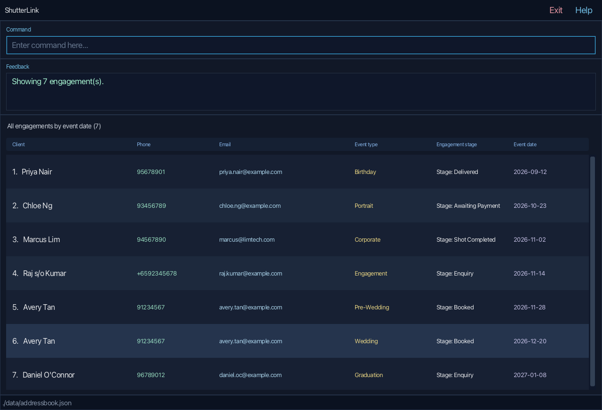

ShutterLink is a **desktop application for managing photography client engagements, optimized for use through a Command Line Interface (CLI)** while retaining the benefits of a Graphical User Interface (GUI). If you type quickly, ShutterLink can help you manage engagements faster than traditional GUI applications.

ShutterLink manages **engagements**, not separate client profiles. Each engagement contains a client's name, phone
number, and email address together with one event type, event date, and workflow stage. A repeat client can therefore
appear in multiple engagement records. Some current UI messages still use the legacy word “contact” to mean an
engagement record.

* Table of Contents
{:toc}

--------------------------------------------------------------------------------------------------------------------

## Quick start

1. Ensure that Java `25` or later is installed on your computer.<br>
   **Mac users:** Ensure you have the precise JDK version prescribed [here](https://se-education.org/guides/tutorials/javaInstallationMac.html).

1. Download the latest `.jar` file from [here](https://github.com/AY2627S1-CS2103T-T08-3/tp/releases).

1. Copy the file to the folder you want to use as the _home folder_ for ShutterLink.

1. Open a terminal, `cd` to the folder containing the JAR file, and run `java -jar addressbook.jar`.<br>
   The ShutterLink window should appear in a few seconds with sample engagement data.
   

1. Type a command in the command box and press Enter to execute it. For example, type **`help`** and press Enter to open the help window.<br>
   Some example commands you can try:

   * `list` : Lists all engagements.

   * `add n/John Doe p/98765432 e/johnd@example.com t/Wedding d/2026-12-20` : Adds an engagement for `John Doe` at the `Enquiry` stage.

   * `delete 3` : Deletes the 3rd engagement shown in the current list.

   * `clear` : Deletes all engagements.

   * `exit` : Exits the app.

1. Refer to the [Features](#features) section below for details of each command.

--------------------------------------------------------------------------------------------------------------------

## Features

<div markdown="block" class="alert alert-info">

**:information_source: Notes about the command format:**<br>

* Words in `UPPER_CASE` are the parameters to be supplied by the user.<br>
  For example, in `add n/NAME`, replace `NAME` with a value such as `John Doe`.

* Items in square brackets are optional.<br>
  For example, `edit INDEX [n/NAME]` can be used as `edit 1 n/John Doe` or with another editable field.

* Prefixed parameters can be in any order.<br>
  For example, if the command specifies `n/NAME p/PHONE_NUMBER`, `p/PHONE_NUMBER n/NAME` is also acceptable.
  For `edit`, the `INDEX` must appear before the prefixed parameters.

* Command words and prefixes are case-sensitive, except that `list`, `upcoming`, and the `sort/date` option are
  case-insensitive. Stage values are also case-insensitive.<br>
  For example, `add ... s/booked` is accepted, while `ADD ...` and `N/John Doe` are not.

* Do not repeat a prefix in the same command. A repeated prefix is rejected instead of silently choosing one value.

* Commands that take no parameters reject unexpected input unless their command section states otherwise.<br>
  For example, `help 123` is rejected because `help` takes no parameters.

* If you are using a PDF version of this document, be careful when copying and pasting commands that span multiple lines as space characters surrounding line-breaks may be omitted when copied over to the application.
</div>

### Field formats

Leading and trailing whitespace around values is ignored when commands are parsed. The following constraints apply:

| Field | Prefix | Accepted format and stored value |
| --- | --- | --- |
| Name | `n/` | One or more alphanumeric characters or spaces; the first character must be alphanumeric. |
| Phone number | `p/` | 8–15 digits, with an optional leading `+`. Spaces and hyphens are accepted but removed when the number is stored and displayed. |
| Email | `e/` | `local-part@domain`, up to 254 characters. The local part uses alphanumeric groups separated by `+`, `_`, `.`, or `-`; those special characters cannot start or end the local part or occur consecutively. The domain has at least two dot-separated labels, allows internal hyphens, and ends in a label of at least two characters. The address is stored in lowercase. |
| Event type | `t/` | 1–40 letters, digits, spaces, or hyphens, with at least one letter or digit. Repeated whitespace is stored as one space. |
| Event date | `d/` | A real calendar date in `YYYY-MM-DD` format, with a year from `0001` to `9999`. |
| Stage | `s/` | `Enquiry`, `Booked`, `Shot Completed`, `Awaiting Payment`, or `Delivered`. Matching ignores capitalization, and the canonical spelling is displayed. |

An `INDEX` is a positive integer referring to the numbering in the list currently displayed. Search, sort, and
upcoming views can therefore change which engagement an index identifies.

### Viewing help: `help`

Opens a concise in-app command reference and provides a link to this User Guide.


Format: `help`


### Adding an engagement: `add`

Adds a client engagement to ShutterLink. The stage is optional and defaults to `Enquiry`.

Format: `add n/NAME p/PHONE_NUMBER e/EMAIL t/EVENT_TYPE d/EVENT_DATE [s/STAGE]`

Examples:
* `add n/John Doe p/98765432 e/johnd@example.com t/Wedding d/2026-12-20`
* `add n/Betsy Crowe p/+65 9123 4567 e/betsycrowe@example.com t/Portrait d/2027-01-15 s/Booked`

Supported stages are `Enquiry`, `Booked`, `Shot Completed`, `Awaiting Payment`, and `Delivered`.
Stage matching is case-insensitive, so `s/booked` is stored and displayed as `Booked`.

An engagement is considered a duplicate when its name, normalized phone number, email address, event type, and event
date match an existing engagement; the stage is not part of duplicate identity. Name, email, and event type comparisons
ignore capitalization. A repeat client can still have multiple engagements with different event types or dates.

After a successful add, the complete list is displayed in insertion order. If the new engagement shares a phone
number or email address with another client identity, ShutterLink also displays a possible-typo warning.

### Listing and sorting engagements: `list`

Use `list` to return to all client engagements after a search or sorted view.
Use `list sort/date` to review all engagements from the earliest event date to the latest.
Past events are included. Engagements on the same date stay in the order they were added.

Formats:
* `list` — all engagements in insertion order.
* `list sort/date` — all engagements by ascending event date.

The heading is `All contacts (N)` or `All contacts by event date (N)`, respectively.
The result panel reports `Showing N contacts.` With no saved engagements, it reports `No contacts to display.`
Here, `N` is the number of displayed engagements. The word “contacts” in these UI messages refers to engagement
records, not separate client profiles.

Examples:
* `list sort/date` brings earlier shoots to the top, including completed dates.
* `list` restores insertion order after sorting.
* `LIST SORT/DATE` also works: the list command, prefix and sort value are case-insensitive.

Each command starts from all records, replacing the previous search or sort.
Displayed indexes are recalculated; subsequent edit, advance, and delete commands use the indexes currently shown.
Sorting does not change the saved records or their insertion order. Restarting restores insertion order.

Only the `sort/` prefix and the value `date` are supported. Spaces and tabs may separate arguments,
but the command must occupy one line. Stage filtering is not available in the current version.

| Invalid input | Feedback |
| --- | --- |
| `list sort/name` | `Invalid sort option. Use list sort/date.` |
| `list sort/` | `Empty value for sort/.` |
| `list sort/date sort/date` | `Duplicate parameter: sort/.` |
| `list stage/Booked` | `Unsupported parameter: stage/.` |
| `list 3` or `list sort/date extra` | `Invalid command format. Usage: list [sort/date]` |

Unsupported prefixes are rejected. Invalid list commands leave both the data and current view unchanged.

### Viewing upcoming events: `upcoming`

Shows all client engagements scheduled for **today and the following six calendar dates**, inclusive.
This is seven calendar days in total, using your computer's local date and timezone when you run the command.

Format: `upcoming`

* Results start from all saved engagements, replacing any previous search or sort.
* Events are sorted from earliest to latest; events on the same date retain insertion order.
* Past events and events seven or more days after today are excluded.
* Displayed indexes start at 1. Edit, advance, and delete use the indexes in this view.
* The heading shows `Upcoming: START_DATE to END_DATE (N)` and feedback shows `Showing N upcoming contacts.`
* With no matching events, the list is empty and feedback is `No events scheduled from START_DATE to END_DATE.`
* Records are not changed or saved by this command. Use `list` to restore all engagements in insertion order.

For example, running `upcoming` on **2026-10-14** includes dates **2026-10-14 through 2026-10-20**.
An event on 2026-10-21 is outside that window. With two matches, the heading is
`Upcoming: 2026-10-14 to 2026-10-20 (2)` and the feedback is `Showing 2 upcoming contacts.`

The command is case-insensitive and takes no arguments: `UPCOMING` works, but `upcoming 7` and
`upcoming sort/date` return `Invalid command format. Usage: upcoming` without changing the current view.
The date window does not advance automatically at midnight; run `upcoming` again to refresh it.
If the date window cannot be calculated, ShutterLink asks you to check the system date and leaves the view unchanged.

### Editing an engagement: `edit`

Edits one or more details of an existing engagement. Use `s/STAGE` to correct or directly set its stage.

Format: `edit INDEX [n/NAME] [p/PHONE] [e/EMAIL] [t/EVENT_TYPE] [d/EVENT_DATE] [s/STAGE]`

* Edits the engagement at the specified `INDEX`. The index refers to the number shown in the current list and must be a positive integer.
* At least one of the optional fields must be provided.
* Existing values will be updated to the input values.
* The stage may be moved forward or backward to any supported value.
* Supplying a value identical to the current value is accepted and reported as a successful edit.
* A successful edit returns to the complete list in insertion order.

Examples:
*  `edit 1 p/91234567 e/johndoe@example.com` edits the phone number and email address of the first engagement.
*  `edit 2 n/Betsy Crower t/Corporate d/2027-03-01 s/Awaiting Payment` edits the name, event details,
   and stage of the 2nd engagement.

### Advancing an engagement stage: `advance`

Advances an engagement to the next workflow stage.

Format: `advance INDEX`

The stage progression is `Enquiry` → `Booked` → `Shot Completed` → `Awaiting Payment` → `Delivered`.
An engagement already at `Delivered` cannot be advanced. Use `edit INDEX s/STAGE` when a stage needs correction.
A successful advance returns to the complete list in insertion order. Attempting to advance `Delivered` leaves the
current view unchanged.

Example: `advance 2` advances the second displayed engagement by one stage.

### Finding engagements: `find`

Find engagements whose selected field contains the search text. Matching is case-insensitive and accepts partial
values; the search text itself is not required to satisfy that field's add/edit format.

Format:

```text
find n/SEARCH_TEXT
find p/SEARCH_TEXT
find e/SEARCH_TEXT
find t/SEARCH_TEXT
```
Where:
* `n/` searches client names.
* `p/` searches stored phone numbers.
* `e/` searches email addresses.
* `t/` searches event types.

Examples:
* `find n/Jonathan` finds `Jonathan Wong` and `Jonathan Tan`.
* `find p/9123` finds normalized phone numbers containing `9123`.
* `find e/jonathan` finds email addresses containing `jonathan`.
* `find t/Wed` finds event types containing `Wed`.

Phone numbers are stored without spaces or hyphens, so searching with digits only is recommended. Each search starts
from all saved engagements and replaces the previous search or sort. The heading becomes `Contacts (N)`; edit,
advance, and delete use the displayed result indexes. Use `list` to restore every engagement.

| Invalid input | Reason |
| --- | --- |
| `find` | No search field was provided |
| `find n/` | The search value is empty |
| `find n/Jonathan p/9123` | More than one search field was provided |
| `find n/Jonathan n/Tan` | The same search field was repeated |

### Deleting an engagement: `delete`

Deletes the specified engagement from ShutterLink.

Format: `delete INDEX`

* Deletes the engagement at the specified `INDEX`.
* The index refers to the number shown in the current list and must be a positive integer.

Examples:
* `list` followed by `delete 2` deletes the second engagement in insertion order.
* `find n/Betsy` followed by `delete 1` deletes the first engagement in those search results.

After deletion from a search, the remaining matching results stay visible. Deleting from a date-sorted or upcoming
view returns to the complete list in insertion order.

### Clearing all entries: `clear`

Clears all engagements from ShutterLink.

Format: `clear`

In the current version, trailing text after `clear` is ignored. Use the documented argument-free form to avoid
accidentally clearing data.

### Exiting the program: `exit`

Exits the program.

Format: `exit`

In the current version, trailing text after `exit` is ignored.

### Saving the data

ShutterLink attempts to save after every successfully executed command except `list` and `upcoming`, which only change
the view. You do not need to save manually. If saving fails after a data-changing command, ShutterLink reports an
error, but the change remains in memory for the current session; the file keeps its last successfully saved contents.

### Editing the data file

ShutterLink data is saved automatically as `data/addressbook.json`, relative to the folder from which the app is
launched (normally the JAR file's folder). Advanced users can update this file while ShutterLink is closed. Each
object in the `persons` array represents one engagement and must contain all six fields:

```json
{
  "persons": [
    {
      "name": "John Doe",
      "phone": "+6591234567",
      "email": "john@example.com",
      "eventType": "Wedding",
      "eventDate": "2026-12-20",
      "stage": "Booked"
    }
  ]
}
```

Use the formats in [Field formats](#field-formats). In particular, `eventDate` must use `YYYY-MM-DD`, and `stage`
must be `Enquiry`, `Booked`, `Shot Completed`, `Awaiting Payment`, or `Delivered`. Duplicate engagement identities
also make the file invalid.

<div markdown="span" class="alert alert-warning">:exclamation: **Caution:**
If your changes make the data file invalid, ShutterLink starts with an empty address book at the next run. The invalid
file remains on disk until a command that triggers saving succeeds; `list` and `upcoming` do not overwrite it. Still,
we recommend backing up the file before editing it.<br>
Furthermore, certain edits can cause the AddressBook to behave in unexpected ways (e.g., if a value entered is outside of the acceptable range). Therefore, edit the data file only if you are confident that you can update it correctly.
</div>

### Archiving data files `[coming in v2.0]`

_Details coming soon ..._

--------------------------------------------------------------------------------------------------------------------

## FAQ

**Q**: How do I transfer my data to another computer?<br>
**A**: Close ShutterLink on both computers. In the folder from which ShutterLink will be launched on the new computer,
create a `data` folder if needed and copy the old `addressbook.json` into it. The resulting path should be
`data/addressbook.json` relative to that launch folder.

--------------------------------------------------------------------------------------------------------------------

## Known issues

1. **When using multiple screens**, if you move the application to a secondary screen, and later switch to using only the primary screen, the GUI will open off-screen. The remedy is to delete the `preferences.json` file created by the application before running the application again.

--------------------------------------------------------------------------------------------------------------------

## Command summary

Action | Format, Examples
--------|------------------
**Add** | `add n/NAME p/PHONE_NUMBER e/EMAIL t/EVENT_TYPE d/EVENT_DATE [s/STAGE]` <br> e.g., `add n/James Ho p/22224444 e/jamesho@example.com t/Wedding d/2026-12-20 s/Booked`
**Advance stage** | `advance INDEX`<br> e.g., `advance 2`
**Clear** | `clear`
**Delete** | `delete INDEX`<br> e.g., `delete 3`
**Edit** | `edit INDEX [n/NAME] [p/PHONE_NUMBER] [e/EMAIL] [t/EVENT_TYPE] [d/EVENT_DATE] [s/STAGE]`<br> e.g., `edit 2 n/James Lee s/Booked`
**Find** | `find n/SEARCH_TEXT`, `find p/SEARCH_TEXT`, `find e/SEARCH_TEXT`, or `find t/SEARCH_TEXT`<br> e.g., `find n/James`
**List** | `list` or `list sort/date`
**Upcoming events** | `upcoming`
**Help** | `help`
**Exit** | `exit`
